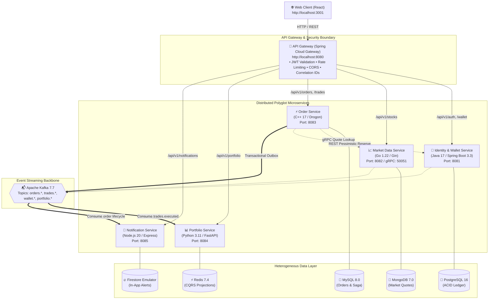

# Stock Trading & Paper Trading Platform — Production-Style Distributed Microservices

[-6DB33F?logo=springboot&logoColor=white)](https://spring.io/projects/spring-boot)
[](https://gin-gonic.com/)
[-00599C?logo=c%2B%2B&logoColor=white)](https://drogon.org/)
[-009688?logo=fastapi&logoColor=white)](https://fastapi.tiangolo.com/)
[](https://nodejs.org/)
[](https://kafka.apache.org/)
[](https://react.dev/)

A robust, polyglot **paper-trading microservices platform** built for university Microservice Architecture & Programming coursework.

> ⚠️ **Academic Simulation Notice**: This system is strictly a simulated paper-trading platform. It never connects to real brokerage accounts, places real orders, or handles real money.

---

## 👥 Service Ownership & Team Structure

| # | Name | Roll No. | Microservice | Tech Stack | Database / Store | Port | Target OS |
|---|---|---|---|---|---|---|---|
| 1 | **Jenil Soni** (Lead) | 23BCE119 | **Identity & Wallet Service** | Java 17 / Spring Boot (**Maven Wrapper**) | PostgreSQL 16 | `8081` | Windows |
| 2 | **Jeel Dhamsaniya** | 23BCE116 | **Market Data Service** | Go 1.22 / Gin & gRPC | MongoDB 7.0 | `8082` | macOS |
| 3 | **Harsh Thakkar** | 23BCE091 | **Order Service** | C++ 17 / Drogon (**Linux Docker**) | MySQL 8.0 | `8083` | Windows |
| 4 | **Kevl Dholakiya** | 23BCE066 | **Portfolio Service** | Python 3.11 / FastAPI (**Local `.venv`**) | Redis 7.4 | `8084` | macOS |
| 5 | **Krish Chothani** | 23BCE151 | **Notification Service** | Node.js 20 / Express (ESM) | Firestore Emulator | `8085` | Windows |
| - | Shared / Jenil | - | **API Gateway** | Java 17 / Spring Cloud Gateway (**Maven**) | Stateless / JWT | `8080` | Windows |
| - | Shared | - | **Eureka Discovery** | Spring Cloud Netflix Eureka (**Maven**) | In-Memory Registry | `8761` | Windows |
| - | Shared | - | **Web Client Terminal** | React 18 / Vite / Dark Theme | Browser SPA | `3001` | Multi-OS |

---

## 🏛️ High-Level System Architecture



---

## 🔍 Development Environment Diagnostics

Before running or building, run the diagnostic verification script:

```powershell
# On Windows PowerShell
.\scripts\verify-prerequisites.ps1

# On macOS / Linux
chmod +x scripts/verify-prerequisites.sh
./scripts/verify-prerequisites.sh
```

---

## 🚀 Execution Path A: Zero-Toolchain Docker Compose (Recommended)

You do **NOT** need standalone Maven, Go, Python, Node, MSVC, or CMake installed on your host computer. Docker handles all compilation and runtimes in isolated containers.

```powershell
# 1. Start all infrastructure and microservices with one command
.\scripts\start-all.ps1

# Or standard Docker Compose
docker compose up --build -d
```

Open **[http://localhost:3001](http://localhost:3001)** in your browser.

---

## 🛠️ Execution Path B: Local Native Development

### 1. Java Services (Identity & Wallet, Gateway, Eureka)
- **Toolchain**: Java JDK 17 LTS.
- **Maven Wrapper**: Standalone Maven is **not required**. Each Java project contains `mvnw.cmd` and `mvnw`.
- **IntelliJ Setup**: Open project $\rightarrow$ File $\rightarrow$ Project Structure $\rightarrow$ Select JDK 17 $\rightarrow$ IntelliJ auto-detects `pom.xml`.
- **PowerShell Run**:
  ```powershell
  cd apps\identity-wallet-service
  .\mvnw.cmd spring-boot:run
  ```

### 2. Python Portfolio Service (Strict Project-Local `.venv`)
Never install dependencies globally. Always use the project-local virtual environment:
```powershell
cd apps\portfolio-service
python -m venv .venv
.\.venv\Scripts\Activate.ps1
pip install -r requirements.txt
pytest tests/ -v
uvicorn app.main:app --port 8084
```

### 3. Market Data Service (Go 1.22 Modules)
- Install Go 1.22 from [go.dev/dl](https://go.dev/dl/) or `winget install GoLang.Go.1.22`.
- Run tests and server:
  ```powershell
  cd apps\market-data-service
  go test ./... -v
  go run ./cmd/server
  ```

### 4. C++ Order Service (Containerized Linux Build)
Host MSVC/CMake is **not required**. The C++ service is compiled inside an Ubuntu Docker build stage to ensure 100% build reproducibility on Windows, macOS, and Linux:
```powershell
docker compose -f deploy/compose/compose.apps.yml build order-service
docker compose -f deploy/compose/compose.apps.yml up order-service
```

### 5. Web Client (React 18 + Vite)
```powershell
cd apps\web-client
npm install
npm run dev
```

---

## 🧪 Automated End-to-End Testing

Run the full distributed trading lifecycle test (User Register $\rightarrow$ Initial ₹100,000 Cash Verify $\rightarrow$ Market Quote Discovery $\rightarrow$ Saga Order Execution $\rightarrow$ Ledger Debit $\rightarrow$ In-App Notification):

```bash
pytest tests/e2e/test_trading_lifecycle.py -v
```

---

## 📚 Detailed Documentation Links

- 📖 **[Windows Single-PC Setup Guide](file:///d:/stock-trading-platform/docs/setup-windows.md)**
- 🌐 **[Multi-PC Distributed Team Setup Guide](file:///d:/stock-trading-platform/docs/setup-multi-pc.md)**
- 🏛️ **[System Architecture & Saga Flow](file:///d:/stock-trading-platform/docs/architecture.md)**
- 👥 **[Service Ownership & Git Branching](file:///d:/stock-trading-platform/docs/service-ownership.md)**
- 📬 **[Event Contracts & Kafka Schemas](file:///d:/stock-trading-platform/docs/event-contracts.md)**
