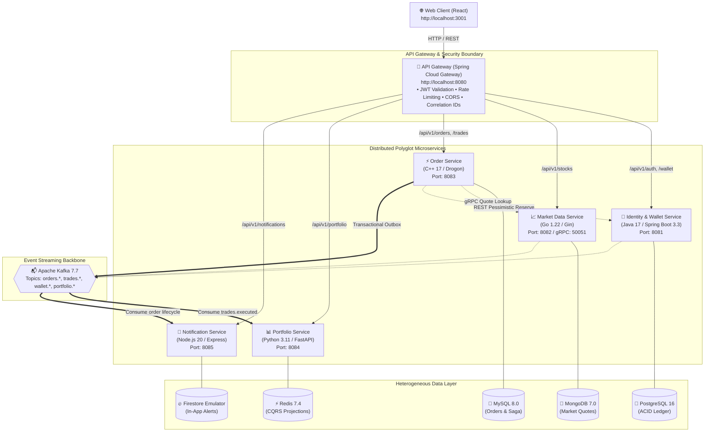

# Architecture Overview

## System Description

The Stock Trading Platform is a **simulated paper-trading application** built as a distributed microservices system. It allows users to register, receive virtual INR balance, browse stocks, place BUY/SELL orders against a deterministic simulated market, and track their portfolio performance.

> **Important**: This is a university project for demonstrating microservice architecture patterns. It never handles real money, connects to real brokerages, or places real stock-market orders.

## High-Level Architecture

## Communication Patterns

### Synchronous (Request-Response)

| From | To | Protocol | Purpose |
|------|-----|----------|---------|
| Web Client | API Gateway | REST/HTTP | All user-facing API calls |
| API Gateway | All Services | REST/HTTP | Request routing with JWT propagation |
| Order Service | Market Data Service | **gRPC** | Real-time quote lookup for order execution |
| Order Service | Identity & Wallet Service | REST/HTTP | Cash reservation, capture, release |

### Asynchronous (Event-Driven)

| Producer | Consumer(s) | Broker | Purpose |
|----------|------------|--------|---------|
| Order Service (via Outbox) | Portfolio Service, Notification Service | Kafka | Trade executed, order status changes |
| Identity & Wallet Service | Order Service | Kafka | Reservation outcomes |
| Market Data Service | Portfolio Service | Kafka | Price updates for unrealized P&L |

---

## Distributed Saga Execution Sequence (BUY Order Workflow)

```mermaid
sequenceDiagram
    autonumber
    actor User as 👤 Trader
    participant Gateway as 🚪 API Gateway
    participant OrderSvc as ⚡ Order Service (C++)
    participant MarketSvc as 📈 Market Data (Go)
    participant WalletSvc as 🔐 Identity & Wallet (Java)
    participant MySQL as 🐬 MySQL DB
    participant Postgres as 🐘 PostgreSQL DB
    participant OutboxRelay as 📬 Outbox Relay
    participant Kafka as 📨 Apache Kafka
    participant Portfolio as 📊 Portfolio Service (Python)
    participant Notification as 🔔 Notification Service (Node.js)

    User->>Gateway: POST /api/v1/orders (BUY 10 TCS)
    Gateway->>Gateway: Validate JWT & Inject X-User-Id
    Gateway->>OrderSvc: Forward order request
    
    rect rgb(20, 30, 45)
        Note over OrderSvc,MarketSvc: Step 1: Real-Time Price Discovery
        OrderSvc->>MarketSvc: gRPC GetQuote("TCS")
        MarketSvc-->>OrderSvc: Return Quote (₹3,850.00)
    end

    rect rgb(20, 45, 30)
        Note over OrderSvc,WalletSvc: Step 2: Pessimistic Cash Reservation
        OrderSvc->>WalletSvc: POST /internal/v1/wallet/reservations (₹38,500.00)
        WalletSvc->>Postgres: SELECT FOR UPDATE & Insert CashReservation
        Postgres-->>WalletSvc: Row Locked & Deducted from Available
        WalletSvc-->>OrderSvc: 201 Created (reservationId)
    end

    rect rgb(45, 35, 20)
        Note over OrderSvc,MySQL: Step 3: Atomic Order Execution & Transactional Outbox
        OrderSvc->>MySQL: BEGIN TRANSACTION
        OrderSvc->>MySQL: INSERT INTO trades (...)
        OrderSvc->>MySQL: UPDATE orders SET status = 'EXECUTED'
        OrderSvc->>MySQL: INSERT INTO outbox_messages (orders.executed, trades.executed)
        OrderSvc->>MySQL: COMMIT TRANSACTION
    end

    rect rgb(20, 45, 30)
        Note over OrderSvc,WalletSvc: Step 4: Capture Reservation Settlement
        OrderSvc->>WalletSvc: POST /internal/v1/wallet/reservations/{id}/capture
        WalletSvc->>Postgres: Debit total paise & write append-only Ledger Entry
        WalletSvc-->>OrderSvc: 200 OK
    end

    OrderSvc-->>Gateway: 201 Created (Order & Trade Details)
    Gateway-->>User: Order Executed JSON Response

    rect rgb(30, 20, 45)
        Note over OutboxRelay,Notification: Asynchronous CQRS & Alert Propagation
        OutboxRelay->>MySQL: Poll pending outbox events
        OutboxRelay->>Kafka: Publish trades.executed
        OutboxRelay->>MySQL: Mark outbox status = 'PUBLISHED'
        
        Kafka->>Portfolio: Ingest trades.executed
        Portfolio->>Portfolio: Recompute Avg Cost Basis & Realized/Unrealized P&L in Redis
        
        Kafka->>Notification: Ingest trades.executed
        Notification->>Notification: Save User In-App Notification in Firestore
    end
```

---

## Distributed Systems Patterns

### 1. Transactional Outbox
- **Where**: Order Service (MySQL), Identity & Wallet Service (PostgreSQL)
- **How**: Business state change + outbox event in same DB transaction
- **Relay**: Polling-based relay (Phase 3), Debezium CDC (Phase 4)
- **Why**: Prevents dual-write bug — ensures events are published if and only if state is committed

### 2. Saga (Orchestrated)
- **Where**: Order Service orchestrates the multi-service workflow
- **Steps**: Validate → Get Quote (gRPC) → Reserve Cash → Execute → Capture/Release → Publish Events
- **Compensation**: Release reserved cash on failure, mark order FAILED
- **Durability**: Saga state persisted in MySQL, recoverable after restart

### 3. CQRS
- **Write Side**: Order Service (MySQL) — authoritative order/trade records
- **Read Side**: Portfolio Service (Redis) — materialized portfolio view
- **Sync**: Kafka events from Outbox → Portfolio consumer → Redis projection
- **Freshness**: Portfolio exposes last-processed event offset

### 4. Event Sourcing (Partial)
- **Where**: Wallet ledger in PostgreSQL
- **How**: Every balance change is an append-only ledger entry
- **Rebuild**: Balance can be recomputed from ledger entries

### 5. Circuit Breaking
- **Where**: API Gateway (Spring Cloud Circuit Breaker), Order Service (gRPC to Market Data)
- **States**: CLOSED → OPEN → HALF_OPEN
- **Behavior**: Fail fast when downstream is unhealthy, auto-recover

## Data Ownership

| Service | Database | Owns |
|---------|----------|------|
| Identity & Wallet | PostgreSQL | Users, roles, password hashes, wallet accounts, ledger, cash reservations, idempotency records |
| Market Data | MongoDB | Stock metadata, simulated quotes, price history, market config |
| Order | MySQL | Orders, trades, order state machine, saga state, outbox records, idempotency records |
| Portfolio | Redis | Materialized portfolio view, holdings, avg cost, P&L, projection checkpoints |
| Notification | Firestore Emulator | Notifications, preferences, delivery status, notification history |

**Rule**: No service may directly read or write another service's database.

## Financial Invariants

1. All monetary values in **integer paise** (1 INR = 100 paise). Never use floating-point for money.
2. Wallet balance = sum of all ledger entries. `available_balance + reserved_balance = total_balance`.
3. No wallet may go negative — enforced by DB constraints and row-level locking.
4. Cash reservation is atomic — concurrent BUY orders cannot overspend.
5. Position reservation prevents concurrent SELL orders from overselling.
6. Idempotency keys prevent duplicate orders and duplicate financial operations.
7. Saga compensation releases reservations on failure — no stuck reserved funds.

## Port Assignments

| Component | Port | Protocol |
|-----------|------|----------|
| API Gateway | 8080 | HTTP |
| Identity & Wallet Service | 8081 | HTTP |
| Market Data Service | 8082 | HTTP |
| Market Data Service (gRPC) | 50051 | gRPC |
| Order Service | 8083 | HTTP |
| Portfolio Service | 8084 | HTTP |
| Notification Service | 8085 | HTTP |
| Eureka Discovery | 8761 | HTTP |
| PostgreSQL | 5432 | TCP |
| MongoDB | 27017 | TCP |
| MySQL | 3306 | TCP |
| Redis | 6379 | TCP |
| Kafka | 9092 (external), 29092 (internal) | TCP |
| Zookeeper | 2181 | TCP |
| Schema Registry | 8081 → 8086 (remapped) | HTTP |
| Kafka Connect (Debezium) | 8087 | HTTP |
| Prometheus | 9090 | HTTP |
| Grafana | 3000 | HTTP |
| Loki | 3100 | HTTP |
| Web Client (dev) | 3001 | HTTP |
| Firestore Emulator | 8088 | HTTP |

## Technology Decisions & Trade-offs

### Why Orchestrated Saga over Choreography?
- **Chosen**: Orchestrated (Order Service coordinates)
- **Rationale**: Easier to reason about, debug, and recover. Single place to inspect workflow state.
- **Trade-off**: Order Service is a coordination point. If it's down, new orders can't start (acceptable for paper trading).

### Why Polling Outbox Relay before Debezium?
- **Chosen**: Polling first (Phase 3), Debezium added later (Phase 4)
- **Rationale**: Simpler to implement, debug, and demonstrate. Debezium adds operational complexity (Kafka Connect, connector config, schema management).
- **Trade-off**: Polling has higher latency (configurable interval). Debezium provides near-real-time CDC.

### Why Redis for Portfolio instead of a SQL database?
- **Chosen**: Redis with persistence (RDB + AOF)
- **Rationale**: Portfolio is a derived read model (CQRS). Redis provides fast lookups for dashboard queries. Data can be rebuilt from Kafka events.
- **Trade-off**: Less query flexibility than SQL. Must handle Redis restart/data loss by replaying events.

### Why not WebSockets for real-time updates?
- **Chosen**: Polling from frontend
- **Rationale**: Simpler to implement correctly. WebSockets add complexity (connection management, reconnection, auth). Polling is sufficient for paper trading latency.
- **Trade-off**: Higher latency for status updates. Can add WebSockets as enhancement.
