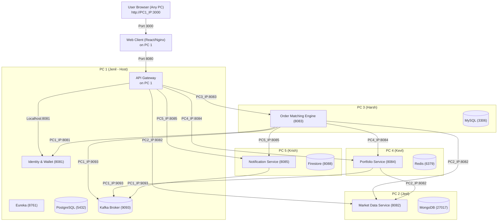

# 🌐 Multi-PC Distributed Deployment Master Guide

This guide describes how to run the Stock Trading Platform across **5 separate physical computers** connected to the same Wi-Fi router, mobile hotspot, or Local Area Network (LAN).

Every service runs in a **Docker container** — no team member needs to install Java, Go, Python, C++, MySQL, PostgreSQL, or Mongo on their host operating system.

---

## 👥 Machine & Service Assignments

| Machine | Member | Role & Services | Local DB | Tech Stack | Exposing Ports |
|:---|:---|:---|:---|:---|:---|
| **PC 1** | **Jenil Soni** (Lead) | Host, API Gateway, Eureka, Identity & Wallet, React Web UI, Kafka Broker | PostgreSQL, Zookeeper | Java 17, React, Kafka | **3000** (UI), **8080** (Gateway), **8081** (Wallet), **8761** (Eureka), **9092/9093** (Kafka), **5432** (Postgres) |
| **PC 2** | **Jeel Dhamsaniya** | Market Data Service & Live Price Simulator | MongoDB 7.0 | Go 1.22 / Gin / gRPC | **8082** (HTTP), **50051** (gRPC), **27017** (MongoDB) |
| **PC 3** | **Harsh Thakkar** | Order Matching Engine & Saga Orchestrator | MySQL 8.0 | C++ 17 / Drogon | **8083** (HTTP), **3306** (MySQL) |
| **PC 4** | **Kevl Dholakiya** | Portfolio & CQRS Materialized View Service | Redis 7.4 | Python 3.11 / FastAPI | **8084** (HTTP), **6379** (Redis) |
| **PC 5** | **Krish Chothani** | Notification & Trade Alerting Service | Firestore Emulator | Node.js 20 / Express | **8085** (HTTP), **8088** (Firestore) |

---

## 🗺️ Network Architecture & IP Dependencies



---

## 📋 Whose IP Does Each PC Need?

| Machine | IP Needed | Why It Needs It |
|:---|:---|:---|
| **PC 1** | **Its own IP (`PC1_IP`)**<br/>**`PC2_IP`**<br/>**`PC3_IP`**<br/>**`PC4_IP`**<br/>**`PC5_IP`** | • `PC1_IP` is advertised by Kafka so all other PCs can connect to it on port 9093.<br/>• The **API Gateway** on PC 1 forwards frontend traffic to PC 2, 3, 4, 5. |
| **PC 2** | **None** | Completely self-contained! Only needs to expose port 8082 and 50051 on the LAN. |
| **PC 3** | **`PC1_IP`**<br/>**`PC2_IP`**<br/>**`PC4_IP`**<br/>**`PC5_IP`** | • Calls `PC1_IP:8081` for cash reservation.<br/>• Calls `PC2_IP:8082` for real-time market stock quotes.<br/>• Calls `PC4_IP:8084` for trade projection.<br/>• Calls `PC5_IP:8085` for user alert.<br/>• Publishes events to `PC1_IP:9093` (Kafka). |
| **PC 4** | **`PC1_IP`**<br/>**`PC2_IP`** | • Consumes trades from Kafka at `PC1_IP:9093`.<br/>• Fetches live prices for P&L valuation from `PC2_IP:8082`. |
| **PC 5** | **`PC1_IP`** | • Consumes order and trade events from Kafka at `PC1_IP:9093`. |

---

## ⚡ Quick Start: 3 Steps for the Whole Team

### Step 1: Find Everyone's LAN IP
All 5 laptops connect to the **same Wi-Fi router or phone hotspot**.
- **On Windows**: Open PowerShell and run `ipconfig`. Look for `IPv4 Address` (e.g. `192.168.1.101`).
- **On macOS / Linux**: Open Terminal and run `ifconfig | grep "inet "` or `ip a` (e.g. `192.168.1.102`).

Share the 5 IP addresses in your group chat.

### Step 2: Configure `.env` on Each PC
In the root directory of the cloned repository on each machine:
```bash
cp deploy/multi-pc/.env.multi-pc.example .env
```
Edit `.env` and fill in the 5 IP addresses agreed upon.

### Step 3: Run Each Assigned Stack
- **PC 1**: `docker compose -f deploy/multi-pc/docker-compose.pc1.yml up -d --build`
- **PC 2**: `docker compose -f deploy/multi-pc/docker-compose.pc2.yml up -d --build`
- **PC 3**: `docker compose -f deploy/multi-pc/docker-compose.pc3.yml up -d --build`
- **PC 4**: `docker compose -f deploy/multi-pc/docker-compose.pc4.yml up -d --build`
- **PC 5**: `docker compose -f deploy/multi-pc/docker-compose.pc5.yml up -d --build`

---

## 📚 Dedicated Step-by-Step Manuals
Read the manual matching your assigned machine:
1. [PC 1 Manual (Jenil - Host, Gateway, Wallet, Web)](PC1_JENIL_GATEWAY.md)
2. [PC 2 Manual (Jeel - Market Data Service & MongoDB)](PC2_JEEL_MARKET_DATA.md)
3. [PC 3 Manual (Harsh - Order Service & MySQL)](PC3_HARSH_ORDER_SERVICE.md)
4. [PC 4 Manual (Kevl - Portfolio Service & Redis)](PC4_KEVL_PORTFOLIO_SERVICE.md)
5. [PC 5 Manual (Krish - Notification Service & Firestore)](PC5_KRISH_NOTIFICATION_SERVICE.md)
