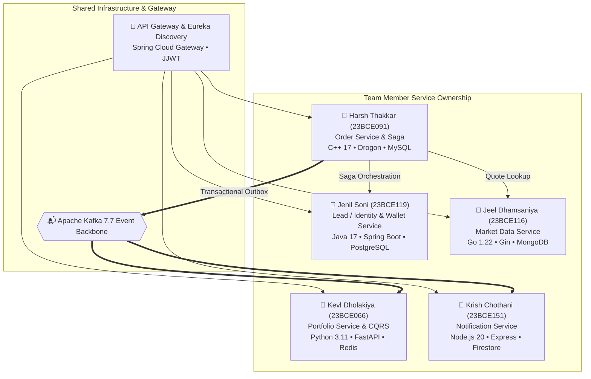
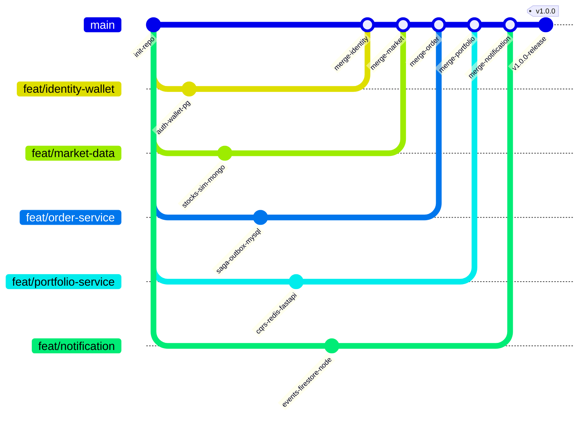

# Service Ownership

## Team Members and Assignments

| # | Name | Roll No. | Service | Language | Framework | Database | OS |
|---|------|----------|---------|----------|-----------|----------|-----|
| 1 | **Kevl Dholakiya** | 23BCE066 | Portfolio Service | Python | FastAPI | Redis | macOS |
| 2 | **Harsh Thakkar** | 23BCE091 | Order Service | C++ | Drogon | MySQL | Windows |
| 3 | **Jeel Dhamsaniya** | 23BCE116 | Market Data Service | Go | Gin | MongoDB | macOS |
| 4 | **Jenil Soni** | 23BCE119 | Identity & Wallet Service | Java | Spring Boot (Maven) | PostgreSQL | Windows |
| 5 | **Krish Chothani** | 23BCE151 | Notification Service | Node.js | Express | Firestore Emulator | Windows |

## Ownership Topology

## Coordination

- **Integration Lead**: Jenil Soni — initial development on single Windows PC, CI/CD coordination
- **Repository**: Shared Git repository with branch-per-service workflow
- **Contracts**: Shared API contracts and event schemas in `/contracts/`

---

## Service Responsibilities

### Identity & Wallet Service (Jenil — Java/Spring Boot)

**Owns**: Users, authentication, authorization, wallet accounts, ledger, cash reservations

**Key Responsibilities**:
- User registration and login
- JWT token issuance and validation
- Password hashing (bcrypt)
- Role-based access control
- Wallet balance management (integer paise)
- Cash reservation for BUY orders (atomic, row-locked)
- Capture/release reservations
- Wallet transaction history (append-only ledger)
- Idempotent financial operations

**APIs Exposed**:
- `POST /api/v1/auth/register` — User registration
- `POST /api/v1/auth/login` — Authentication, returns JWT
- `GET /api/v1/users/me` — Current user profile
- `GET /api/v1/wallet` — Wallet summary (available, reserved, total)
- `GET /api/v1/wallet/transactions` — Wallet transaction history
- `POST /internal/v1/wallet/reservations` — Reserve cash (internal)
- `POST /internal/v1/wallet/reservations/{id}/capture` — Capture reserved cash (internal)
- `POST /internal/v1/wallet/reservations/{id}/release` — Release reservation (internal)
- `POST /internal/v1/wallet/credit` — Credit cash for SELL proceeds (internal)

**Events Published**:
- `wallet.reservation.completed`
- `wallet.reservation.failed`

**Events Consumed**: None (authoritative source)

---

### Market Data Service (Jeel — Go/Gin)

**Owns**: Stock metadata, simulated prices, price history, market configuration

**Key Responsibilities**:
- Stock catalog management (seed data)
- Deterministic price simulation
- Price history storage and retrieval
- Current quote provision
- gRPC endpoint for internal quote lookup
- Configurable simulation parameters
- Market data events

**APIs Exposed**:
- `GET /api/v1/stocks` — List all stocks
- `GET /api/v1/stocks/{symbol}` — Stock details
- `GET /api/v1/stocks/{symbol}/quote` — Current simulated quote
- `GET /api/v1/stocks/{symbol}/history` — Price history
- `GET /health` — Health check
- `GET /ready` — Readiness check
- gRPC `QuoteService.GetQuote` — Internal quote lookup

**Events Published**:
- `market.price.updated` (periodic, controlled)

**Events Consumed**: None

---

### Order Service (Harsh — C++/Drogon)

**Owns**: Orders, trades, order state machine, saga state, outbox records

**Key Responsibilities**:
- Order creation with idempotency keys
- Order validation
- Saga orchestration (BUY/SELL workflows)
- gRPC call to Market Data for quotes
- REST calls to Wallet for cash reservation/capture/release
- Trade execution against simulated quotes
- Order state machine (CREATED → VALIDATING → ACCEPTED → EXECUTING → EXECUTED)
- Cancellation (race-safe)
- Transactional Outbox (order + outbox in same MySQL transaction)
- Outbox relay (polling-based)
- Trade records

**APIs Exposed**:
- `POST /api/v1/orders` — Submit order
- `GET /api/v1/orders` — List user's orders
- `GET /api/v1/orders/{id}` — Order details
- `POST /api/v1/orders/{id}/cancel` — Cancel order
- `GET /api/v1/trades` — User's trade history

**Events Published (via Outbox)**:
- `orders.created`
- `orders.accepted`
- `orders.rejected`
- `orders.executed`
- `orders.cancelled`
- `trades.executed`

**Events Consumed**:
- `wallet.reservation.completed`
- `wallet.reservation.failed`

---

### Portfolio Service (Kevl — Python/FastAPI)

**Owns**: Materialized portfolio view, holdings projection, P&L calculations

**Key Responsibilities**:
- Consume `trades.executed` events from Kafka
- Build and maintain portfolio projection in Redis
- Calculate average cost basis
- Calculate realized P&L (on SELL)
- Calculate unrealized P&L (using latest market prices)
- Track projection freshness (last processed offset)
- Support portfolio rebuild from event replay

**APIs Exposed**:
- `GET /api/v1/portfolio` — Portfolio summary
- `GET /api/v1/portfolio/holdings` — All holdings
- `GET /api/v1/portfolio/performance` — P&L summary
- `GET /api/v1/portfolio/positions/{symbol}` — Position detail

**Events Published**:
- `portfolio.updated`

**Events Consumed**:
- `trades.executed`
- `market.price.updated` (for unrealized P&L)

---

### Notification Service (Krish — Node.js/Express)

**Owns**: In-app notifications, preferences, delivery status

**Key Responsibilities**:
- Consume order lifecycle events from Kafka
- Persist notifications (Firestore Emulator)
- Idempotent notification creation
- Notification preferences management
- Notification history and read status

**APIs Exposed**:
- `GET /api/v1/notifications` — User's notifications
- `PATCH /api/v1/notifications/preferences` — Update preferences
- `POST /internal/v1/notifications/test` — Test notification (dev only)

**Events Published**: None

**Events Consumed**:
- `orders.accepted`
- `orders.rejected`
- `orders.executed`
- `orders.cancelled`
- `trades.executed`

---

## Branching Strategy

- Each member works on their service branch
- PRs to `main` require at least one reviewer
- Integration testing happens on `main`
- Contracts changes require discussion with affected service owners
